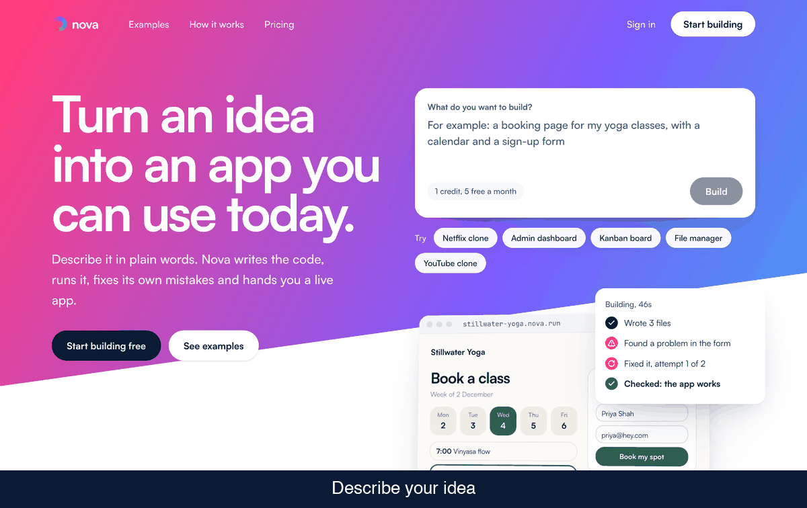
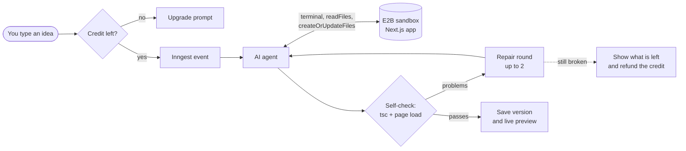
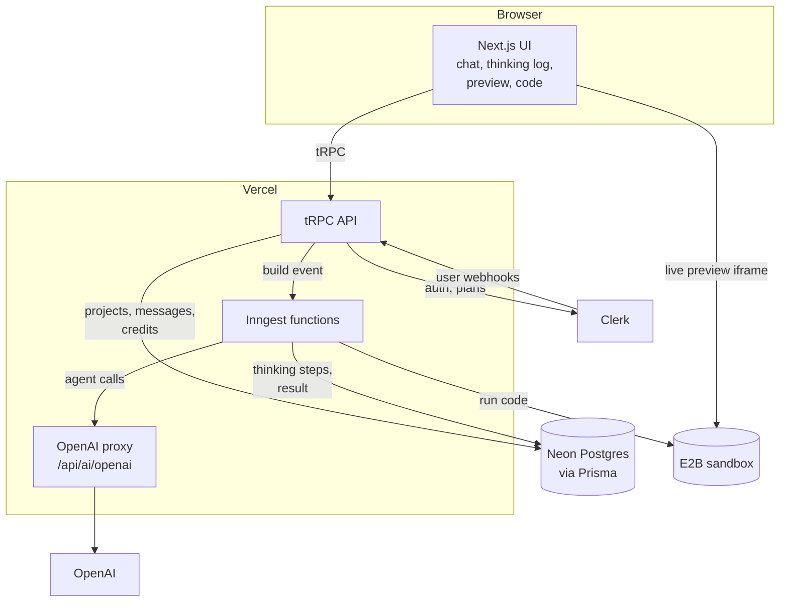
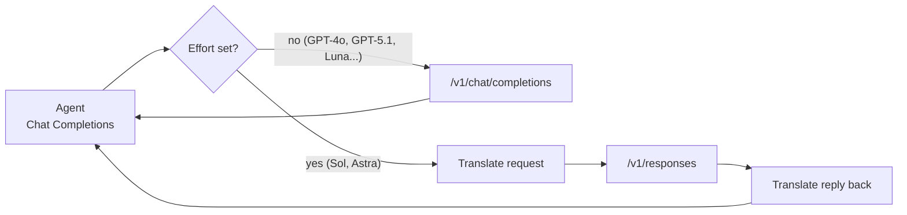

# Nova

Describe an app in plain words. Nova's AI agent writes the code, runs it in a cloud sandbox, checks it, fixes what is broken and shows you a live preview.

**Live:** https://nova-five-black.vercel.app



## What it does

- **Build from a prompt.** The agent writes a Next.js app inside an isolated E2B sandbox.
- **Full-stack apps.** When an app needs to keep data, the agent adds API routes, server actions and a SQLite database with a schema and seed data, plus email and password sign-in when the app needs accounts. The self-check calls each API route.
- **Design references.** Attach screenshots, screen recordings (sampled into frames in the browser), PDFs, text or code files and links. A vision model turns them into a design brief the build follows, and uploaded images are copied into the app. Files are kept in private Vercel Blob storage.
- **Self-check and repair.** After writing, Nova runs TypeScript and loads the app's home page. Any error goes back to the agent to fix before you see the result.
- **Real thinking log.** Each step the agent takes is shown as it happens, collapsed to two lines with a toggle.
- **Live preview, code and versions.** Every change is saved as a version you can open again.
- **Chat.** Ask questions about your app without spending a build credit.
- **Models.** Free: GPT-6 Luna, GPT-4o Mini. Pro adds GPT-4o, GPT-4 Turbo, GPT-6.1 Terra, GPT-5.1, GPT-6.2 Sol and GPT-6.2 Astra. Sol and Astra have an effort setting (Low to Extra high).
- **Credits.** Free: 5 builds a month. Pro: 100 builds a month. A build that fails is refunded.

## How a build works



Every step the agent takes is written to the thinking log, so you watch the real work, not a spinner.

## Architecture



### Model routing

GPT-6.2 Sol and Astra only accept tools together with a reasoning effort on OpenAI's Responses API. The agent library speaks Chat Completions, so Nova's proxy translates those calls both ways. Other models pass straight through.



## Stack

Next.js 15 (App Router), React 19, Tailwind CSS 4, tRPC, TanStack Query, Prisma on Neon Postgres, Clerk (auth and billing), Inngest with Agent Kit (background agent), E2B (sandboxes), OpenAI.

## Run it locally

Requires Node.js 20 or later and accounts for Clerk, Neon (or any Postgres), Inngest, E2B and OpenAI.

1. Install:
   ```bash
   git clone https://github.com/Soumyadip2003-AI/Nova.git
   cd Nova
   npm install
   ```
2. Set these environment variables (for example in `.env.local`):
   ```
   DATABASE_URL
   OPENAI_API_KEY
   E2B_API_KEY
   E2B_TEMPLATE_ID
   NEXT_PUBLIC_CLERK_PUBLISHABLE_KEY
   CLERK_SECRET_KEY
   CLERK_WEBHOOK_SIGNING_SECRET
   CLERK_PRO_PLAN_ID
   CLERK_PRO_PLAN_SLUG
   CLERK_PRO_PLAN_NAME
   INNGEST_EVENT_KEY
   INNGEST_SIGNING_KEY
   NEXT_PUBLIC_APP_URL=http://localhost:3000
   ```
3. Create the database tables:
   ```bash
   npx prisma migrate deploy
   ```
4. Start the app and, in a second terminal, the Inngest dev server:
   ```bash
   npm run dev
   npx inngest-cli@latest dev
   ```

The sandbox image lives in `sandbox-templates/nextjs`. Build it with the E2B CLI and put its ID in `E2B_TEMPLATE_ID`.

## Checks

```bash
npm test   # lint and typecheck
npm run build
```

## Contact

Nova is run by Soumyadip Sarkar, India. Email soumyadip.0202@gmail.com or open an issue at https://github.com/Soumyadip2003-AI/Nova/issues.

## License

MIT. See [LICENSE](LICENSE).
